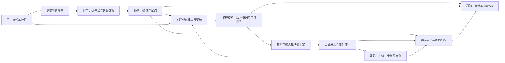

# AI Hub Platform 当前需求基线

> 整理开始：2026-10-07；收尾核对：2026-10-08。依据：当前工作区源码、契约、迁移、自动化测试及历史交付记录；Git 基准为 `437ccfb47f0d35bdabf93b31aaee2d0b7cf87685`，同时包含整理开始前已有的未提交修改。
> 本文件统一产品范围、业务规则及需求变更口径。[需求追踪矩阵](traceability.md)连接实现与证据，[统一验收手册](acceptance.md)规定验收步骤。历史设计、计划和测试报告不再并列作为当前需求。

## 1. 产品目标与范围

平台服务单企业员工，连接“发现业务问题 → 提交创新需求 → 评审与认领 → 验证和试点 → 应用交付与审核 → 员工使用与反馈 → 数据分析与治理”。也允许员工直接创建应用，不必先创建创新需求。Portal 提供应用及 `skill`、`plugin`、`mcp` 的资源浏览和个人中心，Console 提供企业应用、需求、组织与安全管理。

当前边界为单企业、无 `tenant_id` 的模块化单体，使用 React、NestJS、PostgreSQL、Outbox、Docker Compose 与对象存储。平台管理目录、交付资产及治理流程；目标应用的业务运行和内部授权由目标应用负责。目录可见不等于取得目标系统权限。V2/V3、多租户、微服务、Kubernetes、积分排行榜和 AI 自动审批保留为历史提案，不属于当前交付承诺。

原设计针对约 600 名员工，提出上线后 30 天发布 10 个应用、月活 50%、80% 审核在 2 个工作日完成、需求转化率 50%、重大安全事故 0，以及可用性 99.5%、RPO 15 分钟、RTO 2 小时。这些是产品/运维目标，尚无本次生产测量或业务签核证明。原“1 个月实施”和“M1–M9 路线图”均为历史排期；后续工作按第 7 节的门禁推进，不据旧日期推断延期或完成。

## 2. 角色、入口与授权

| 身份或资源关系             | 当前使用规则                                                                                                                   |
| -------------------------- | ------------------------------------------------------------------------------------------------------------------------------ |
| 匿名访客                   | 仅 Portal 的可选认证读接口；只能读取已发布资源及公开内容，收藏、评论写入、投票、个人中心、通知均需登录                         |
| `employee`                 | 当前基础分发角色；浏览目录、提交需求、提交认领方案、创建/管理本人应用、互动、读取本人通知；没有需求审核或应用审核权限          |
| `super_admin`              | 当前管理分发角色，权限为 `*`；仍受非自审、资源归属、合法状态和审计约束                                                         |
| 应用负责人、维护人         | 是应用的资源关系，不是额外分发角色。负责人负责草稿、版本与交付；维护人在应用写链上只读，反馈处理等功能有独立授权规则           |
| 需求负责人、协作者、运营者 | 认领方案确认后形成需求团队；状态推进、协作、评分、合并还须满足对应权限及资源关系                                               |
| 既有专业/自定义角色        | 定义与历史分配仍保留，运行时仅合并 active 角色权限；不能新增分发与两种 V1 角色并行的角色体系，也不能把保留定义解释为权限已失效 |

前后端以 actor 的 `permissions` 授权，服务端继续核对员工状态、有效会话、资源范围、负责人和状态；菜单隐藏不能代替 API 授权。运行授权只合并 active 角色权限，停用角色的分配记录保留供管理读取，通知广播排除停用角色/员工；GAP-03 的定向真库门禁已通过，见[实施门禁](gates.md)。详见[访问控制矩阵](../access-control-matrix.md)。

Console 的实际一级菜单为应用市场、创新广场、应用管理、数据看板、组织管理、系统安全和站内通知，按权限显示。审核通过应用管理子页进入；`/assistant` 保留路由，当前没有一级菜单入口。Console 部署在 `/console/`；Portal 位于根路径，API 使用同源 `/internal/*`。该部署约定不证明 Portal 客户端已在生产接入，详见[路由说明](../deployment/portal-console-routing.md)和[Portal 接口手册](../handoff/ai-hub-portal-api.md)。

## 3. 完整业务链路

图描述目标业务衔接；具体实现差异和未验收门禁见第 7 节，不代表所有箭头均已通过真实环境验收。

### 3.1 身份与组织（REQ-ID）

- **REQ-ID-01 登录与会话**：密码登录采用挑战及加密传输流程，服务端建立 HttpOnly `aihub_eid`、`aihub_sid` Cookie；退出、过期或撤销后不能继续访问。前端不持久化会话令牌，401 后清理用户状态与缓存。PEM 公钥从私钥派生，私钥保持不可导出；GAP-01 已通过配置路径的定向真库门禁，生产部署仍另行验收。
- **REQ-ID-02 组织与角色管理**：提供员工、部门、角色分配、会话撤销、同步配置与审计能力；在职状态和组织范围限制访问。员工可读授权部门及部门成员选择数据，不因此取得全局员工管理权。
- **REQ-ID-03 钉钉身份集成**：只有登录 options 返回 `dingtalk_sso` 时展示入口；OAuth state、短时 handoff、有效员工/绑定关系和安全回跳必须校验。组织同步和绑定能力保留；外部配置及真实联调是启用前置，不能沿用旧文档“所有密码登录必须绑定钉钉”的描述。

### 3.2 应用从草稿到市场（REQ-APP）

- **REQ-APP-01 创建与恢复草稿**：打开新增页不创建空记录；有效下一步、保存或首次上传时惰性创建，共享进行中的请求避免重复创建。编辑复用应用 ID，提交失败显示具体错误，重复版本号被拒绝。
- **REQ-APP-02 完整内容**：草稿包括名称、部门、维护人列表、分类/标签、图标、截图/附件、介绍、使用手册、示例、FAQ、受众、AI/数据风险声明、交付项、版本及更新说明。允许未完整草稿保存，提交时执行完整校验。切换部门应重选对应维护人；编辑时保留已有人员回显。
- **REQ-APP-03 多渠道交付**：`web`、`desktop`、`mobile`、`mini_program` 可以组合选择；落库和发布门禁按实际选择的渠道，不要求所有新应用具备四个渠道。Web URL 校验白名单；桌面/移动端记录 OS/平台；小程序记录平台、appId、二维码资产及启用状态，校验资产归属和二维码内容。
- **REQ-APP-04 资产与制品**：图标、截图、附件、二维码、制品、安装包通过受保护上传接口存储。制品版本链包括上传 → 完成 → Worker 扫描/摘要/签名校验 → 创建版本；扫描失败不放行，未签名制品必须显式确认风险。当前配置的制品上限为 64 MiB；旧设计中的 2 GB、分片续传和 EXIF 处理不计为已交付。
- **REQ-APP-05 提交与快照**：提交完整草稿时写入版本快照、渠道、受众、维护人、待审分类标签及审核队列。首次提交 `draft → in_review`；下架后可重新提交。已发布应用提交更新保持 `published`，以 `pendingVersionId` 表示待审核版本，旧生效版本继续可用。桌面/移动向导制品衔接见 `GAP-04`。
- **REQ-APP-06 审核与生效**：仅具备 `application.review` 且认领该队列的其他审核人可裁决；应用负责人和维护人不能自审，超管也不能绕过。`reject`、`request_changes` 必须填写意见并恢复提交前状态；`approve` 激活新版本并自动上架/更新目录。独立 `approved → publish` 仅保留兼容路径。向导队列 SLA 为 2 个工作日；旧版本提交接口仍有 24 小时 SLA，见 `GAP-05`。
- **REQ-APP-07 分类与标签治理**：现有重名分类/标签复用；新名称先进入待审项，不提前进入公共筛选元数据。审核通过正式入库，驳回/退回清理待审项，审核人可删除不合适的待审项。
- **REQ-APP-08 后续治理**：支持发布、下架、撤回待审核、负责人移交、版本快照/差异、回滚和归档；草稿仅负责人可物理删除，其他状态不能用删除替代治理。回滚限制同应用且不是当前版本。归档不能在向导编辑，但旧制品版本链保留新版本审核恢复路径，需按验收案例确认。
- **REQ-APP-09 创作者视图**：负责人/维护人读取本人应用列表、版本差异、校验报告与聚合数据；可以查看和处理应用反馈。不能提供员工访问明细来替代聚合分析。

生命周期按两条入口分别保留：完整草稿提交用于内容向导；已验证制品创建版本再提交用于制品版本链。两条入口应满足相同的审核、安全及生效约束；存在代码差异时记录缺口，不将某一入口的单测结果推广到另一入口。

### 3.3 创新需求到应用（REQ-DEM）

- **REQ-DEM-01 结构化提交**：填写标题、问题、业务场景、影响、期望结果、当前做法、数据敏感性、可选 AI 思路和附件；选择全部/部门/员工受众、子部门及匿名展示。本人可编辑 `draft`、`rejected`；提交进入 `pending_review`。
- **REQ-DEM-02 评审与可见性**：有权限的审核人选择发布或驳回；驳回必须填写原因，发布进入 `pending_claim`。列表在排序分页前过滤受众；普通读者的匿名投影清除真实姓名、员工 ID 和部门，身份审查须授权并记审计。
- **REQ-DEM-03 认领方案与团队**：员工提交负责人、协作者、解决思路、验证周期、资源诉求和意向；可撤回本人方案。管理员确认选中方案后建立负责人/团队，使用 `expectedVersion` 防止竞争覆盖；释放认领回到待认领。旧直接认领接口保留，不能据此省略新方案链的验收。
- **REQ-DEM-04 优先级**：业务价值、影响人数、频率、战略契合、技术可行性、合规风险、成本各为 1–5。固定分数为 `0.20*businessValue + 0.15*impactedHeadcount + 0.10*usageFrequency + 0.15*strategicFit + 0.10*technicalFeasibility + 0.15*(6-dataComplianceRisk) + 0.15*(6-implementationCost)`，保留一位小数和解释；授权管理员可确认高/中/低及调整说明。
- **REQ-DEM-05 进展与试点**：需求负责人或授权运营者记录官方进展、推进状态、创建/更新试点及结果，关闭必须填写原因。创建试点记录不等同于把需求状态自动改为 `pilot`；当前创建接口仍只接受 `claimed`、`pilot`，与 `validating → pilot` 状态推进需分别核验。
- **REQ-DEM-06 解决方案与转化**：关联候选、试点、正式解决方案，或通过桥接创建应用草稿；不能跳过标准应用审核直接上架。关联主解决方案和 `converted` 状态是不同操作，不把建立关联自动视为完成转化。
- **REQ-DEM-07 讨论与治理**：支持点赞、评论/回复、评论点赞、举报与隐藏/恢复、合并；匿名作者查询有独立授权和审计，拒绝跨需求使用评论/举报 ID。合并保留来源与目标关联及历史。
- **REQ-DEM-08 附件与并发**：附件有格式/魔数/大小/摘要检查，草稿附件删除要求提交人和可编辑状态；需求主记录、进展、审核等历史不得随意删除。高价值变更使用乐观版本及数据库约束；需求附件扫描衔接见 `GAP-06`。

当前 10 个状态为 `draft`、`pending_review`、`rejected`、`pending_claim`、`claimed`、`validating`、`pilot`、`converted`、`closed`、`merged`。主路径为 `draft → pending_review → pending_claim → claimed → validating → pilot → converted → closed`；审核可退回 `rejected` 后重新提交，确认/释放认领、合并使用专用操作。推进接口还允许 `claimed → pilot/converted/closed`、`validating → converted/closed`、`pending_claim → closed`，不能套用旧九状态名。

### 3.4 目录使用、互动与反馈（REQ-CAT、REQ-INT）

- **REQ-CAT-01 发现**：应用市场支持关键词、分类、标签、渠道、排序与分页；仅返回已发布且满足受众条件的应用。分页总数与实际可见范围一致，不从前端演示数组推导。
- **REQ-CAT-02 详情与资产**：详情、截图、二维码和交付资产都先执行相同可见性检查；不可见目录对象按 404 处理，避免泄露存在性。管理读接口有各自 403/404 语义，不能一概替换。
- **REQ-CAT-03 使用与行为记录**：Web 跳转授权入口、桌面/移动下载或使用已配置链接、小程序显示二维码；缺失渠道/资产给出明确不可用信息。解析交付与记录 `initiated` 行为不证明用户已成功运行目标应用。
- **REQ-INT-01 员工互动**：对可见应用点赞、整数评分、评论/回复；对隐藏、下架或不可见资源拒绝互动。前端暂未开放的匿名评分不能列为已交付用户功能。
- **REQ-INT-02 举报治理**：授权治理人审核举报、隐藏/恢复评论和查看必要匿名身份；保留审计，不静默删除历史。
- **REQ-INT-03 反馈闭环**：用户提交问题/建议并查看本人反馈，负责人/维护人查看和处理该应用反馈；完成或关闭必须填写处理说明，反馈 ID 与应用绑定，记录审计和行为事件。

### 3.5 分析与通知（REQ-ANA、REQ-NOT）

- **REQ-ANA-01 数据来源**：规范行为事件 → 保留/每日聚合 → 带版本指标 → 看板；原始分析事件保留 180 天，日期范围校验，不影响业务审计历史。采集、聚合和指标定义分别需要证据，不能把页面有图表等同于数字正确。
- **REQ-ANA-02 看板与权限**：当前服务端提供 `platform`、`market`、`application`、`innovation`、`review`、`department`、`risk`、`runtime`、`integration`、`demand_value` 共 10 个看板键，分别检查权限与数据范围；`demand_value` 复用创新分析权限。负责人/维护人应能读取本人应用聚合，创作者摘要已提供该入口；单应用 Dashboard 服务虽有负责人分支，HTTP Guard 仍先要求分析读取权限，普通 `employee` 的该看板链路尚未贯通，见 `GAP-07`。
- **REQ-ANA-03 导出**：导出请求、读取、行策略、身份脱敏、完成/失败和下载登记可审计。创建接口在请求内返回 `exportId` 及脱敏后的 `rows`；`POST /internal/analytics/exports/:exportId/download` 校验导出权限和任务归属后，仅登记审计并返回 `{ downloaded: true, exportId }`。跨请求人操作还需 `analytics.export.manage`。文件流、短期链接及后台异步导出仍属未实现设计，前端文件保存需单独验收；失败通知的持久化限制见 `GAP-07`。
- **REQ-ANA-04 助手**：仅授权的指标、日期、单位、数值可组成最小脱敏上下文，禁止传出员工身份、内部 URL、文件及匿名身份；外部失败安全降级并审计。当前生产模块装配 `UnavailableDifyAssistantPort`，真实 Dify/Qwen 问答未交付。
- **REQ-NOT-01 业务通知**：沿用 21 场景矩阵、模板、收件人关系和幂等键；业务事务提交后尽力创建通知，通知失败不能撤销已提交的业务。当前生产者接线不等于所有业务入口/角色都能实际收信，见 `GAP-02`。
- **REQ-NOT-02 站内消费**：Console/Portal 读取同一员工的通知、summary 未读数，点击已读、批量已读、30 秒轮询、刷新保持状态；详情来自真实 payload，不能用 demo 名称/版本号替代。
- **REQ-NOT-03 外部投递**：通知与 `notification.created` Outbox 在通知事务内写入，Worker 负责重试和状态记录；真实钉钉发送端口仍为 unavailable stub，站内与外部投递分别验收。

21 场景的契约详见[通知系统说明](../specs/notification-system.md)，旧验证证据集中于[通知历史验收记录](../audit/notification-verification-2026-08-29.md)。

### 3.6 Portal 扩展链（REQ-POR）

- **REQ-POR-01 浏览与公开边界**：首页、四类资源、部门、技能包、Apps Hunt、内容页和评论读取支持可选认证；无效会话不能降级为匿名。匿名公开缓存、已登录 private/no-cache、`Vary: Cookie` 按端点执行。Portal 当前按已发布状态读取应用，未复用 Catalog 受众谓词，见 `GAP-08`。
- **REQ-POR-02 应用一致性**：Portal `resourceType=app` 写入统一委托 `ApplicationService`，`resourceId=applicationId`；版本保存只更新草稿，提交时才创建正式版本；审核复用标准队列和自审限制。禁止形成第二套应用发布事实。
- **REQ-POR-03 自有资源**：`skill/plugin/mcp` 使用独立资源和版本，`draft/withdrawn → in_review → approved → published → withdrawn`；所有者不能自审。技能包及资源目录元数据不等同于平台已执行、安装或托管这些资源。
- **REQ-POR-04 个人中心与活动**：登录后收藏、评论/一层回复、个人发布/收藏/评论视图及周期投票；投票验证周期、条目关系与重复限制。通知复用 REQ-NOT-02。跨仓库 Portal UI 与最终根路径部署仍需单独联调验收。

### 3.7 安全、交付与运维（REQ-OPS）

- **REQ-OPS-01 信任边界**：DTO 输入校验、富文本清洗、Cookie/CSRF、限流、防重放、URL 白名单、SSRF 和敏感信息脱敏；拒绝路径也有明确错误和审计。GAP-01/03 已修复并通过定向门禁，GAP-06/09 仍待处理；完整安全及生产验收不由单项通过替代。
- **REQ-OPS-02 事务与 Worker**：核心业务状态、审计、Outbox 同事务；Worker 按至少一次语义投递，依靠稳定幂等键避免业务重复，暴露重试/失败和健康证据。
- **REQ-OPS-03 构建与发布**：开发可迁移和初始化 demo；生产 `init:production` 只迁移，不写演示数据。以 package/lockfile、Compose 与 CI 为版本事实；门禁、不可变镜像、迁移兼容与回滚按交付手册执行。
- **REQ-OPS-04 生产恢复与观测**：双机 PostgreSQL 主备、对象复制、TLS/DNS/fencing、备份恢复、监控告警及事件响应以运维手册为操作依据。模板和本地检查不能替代真实双机、RPO/RTO、告警送达与 UAT 签核证据。

## 4. 接口、数据与证据如何衔接

| 链路      | 主要 API 入口                                                        | 持久化事实                                                    | 验收取证                                                      |
| --------- | -------------------------------------------------------------------- | ------------------------------------------------------------- | ------------------------------------------------------------- |
| 身份      | `/internal/identity/*`                                               | 员工、部门、角色、会话、绑定、身份审计                        | 登录/退出/撤销与权限负向测试                                  |
| 应用      | `/internal/applications/*`                                           | 应用、草稿、版本/快照、维护人、渠道/目标/资产、审核队列、审计 | 同一 applicationId/versionId 的提交、裁决、目录生效及拒绝路径 |
| 需求      | `/internal/demands/*`                                                | 需求、方案、团队、评分、进展、试点、应用关联、讨论/举报、审计 | 同一 demandId/version 的认领竞争、匿名、转化与关联            |
| 使用/反馈 | `/internal/catalog/*`、应用 `/interactions/*`、`/internal/creator/*` | 目录读模型、交付行为、互动、反馈                              | 受众 → 交付资产 → 互动 → 处理说明                             |
| 分析      | `/internal/analytics/*`                                              | 行为事件、聚合、指标版本、导出任务、助手审计                  | 源事件与数字对账、脱敏结果、下载授权                          |
| 通知      | `/internal/notifications/*`、`/internal/portal/notifications/*`      | notifications、Outbox、投递尝试                               | 业务触发 → 真实收件人记录 → summary → 已读持久化              |
| Portal    | `/internal/portal/*`                                                 | app 复用应用事实；自有资源、收藏/评论、技能包、投票、内容页   | 两端 app 一致及匿名/登录缓存隔离                              |

字段枚举和响应形状以[contracts](../../packages/contracts/src/)、当前 controller DTO 和[数据库 schema](../../packages/database/src/schema.ts)为核对入口。本文不复制另一套 DTO；变更字段时同时更新契约、接口说明、需求 ID、验收案例和追踪行。

## 5. 已合并的变更口径

| 旧描述                               | 当前统一口径                                        | 处理                                 |
| ------------------------------------ | --------------------------------------------------- | ------------------------------------ |
| 多专业角色分发、五角色 demo 为标准   | 只新增分发 employee/super_admin；既有角色仍可能授权 | 更新权限矩阵；旧测试记录标历史       |
| 新建页自动建空草稿、四渠道全部必填   | 惰性创建、实际多选渠道落库/校验                     | 纳入 REQ-APP-01/03                   |
| 审核到 approved，再由负责人发布      | 常规审核通过自动生效；旧 publish 路径兼容           | ADR 0004 标出被覆盖条款              |
| 禁止所有应用物理删除                 | 仅负责人可删除 draft，正式生命周期保留              | 纳入 REQ-APP-08                      |
| 需求九状态、四维评分、单人直接认领   | 十状态、七维评分、认领方案确认；旧接口保留          | 纳入 REQ-DEM-01–08；专用入口分别验收 |
| 通知多项待接线/“21 场景全部验收完成” | 已有接线，但角色、入口、失败持久化和真环境存在缺口  | 更新场景状态，合并五份重复通知报告   |
| 钉钉强制绑定、助手已可真实问答       | SSO 条件启用；钉钉投递、Dify 仍不可用装配           | 纳入条件能力与后续门禁               |
| 2 GB 分片上传、异步导出、九个看板    | 64 MiB 配置上限；导出在请求内运行；服务端十看板     | 将未落地设计留在差异清单             |
| Portal app 独立状态/表               | 统一 ApplicationService；自有资源仍单独生命周期     | 纳入 REQ-POR-02/03                   |
| 历史 PASS 等同当前上线可用           | 自动化、本地真库、浏览器、外部联调、生产签核分层    | 统一验收手册限定证据范围             |

## 6. 文档使用与变更规则

需求和业务规则从本文件进入；逐项实现/测试映射从 traceability 进入；执行验证从 acceptance 进入。开发/接口/运维手册保留操作细节，历史设计/路线图/审计保留决策过程和原批次证据。[历史材料索引](../superpowers/README.md)说明保留范围，旧文档不能继续新增另一套“最终需求”。

后续变更沿用稳定 REQ ID；在本基线更新行为，追踪矩阵更新实现/测试/状态，验收手册更新案例。单测通过、存在测试文件、历史报告 PASS、真实端到端通过和生产签核分别记录，不能混用。尚未实现的历史愿景只在明确重新纳入范围后转为当前需求。

## 7. 当前缺口与后续门禁

| 编号   | 当前事实与需求差异                                                                                                                              | 优先级与关闭条件                                                                                  |
| ------ | ----------------------------------------------------------------------------------------------------------------------------------------------- | ------------------------------------------------------------------------------------------------- |
| GAP-01 | 已修复：从 PEM 派生公钥，私钥仍保持不可导出；加密往返及真实 IdentityModule 配置、挑战、Cookie 登录通过                                          | P0 定向门禁通过；完整部署启动与生产验收仍按[实施门禁](gates.md)推进                               |
| GAP-02 | 审核/运营广播和矩阵授权仍依赖旧角色；submitDraft、confirmClaim 已补事务外 queue 并通过 L1，实际通知落库尚未完成                                 | P0：两种分发角色、负责人资源关系及两类提交/认领入口均能真实收信；21 场景按真库逐项验收            |
| GAP-03 | 已修复：运行授权只取 active 角色，管理读取保留原分配；角色广播排除停用角色及员工                                                                | P0 定向门禁通过：真实 Cookie 会话停用后 403、恢复后 200；完整菜单/浏览器另验                      |
| GAP-04 | 向导 submitDraft 创建 `artifactKey=null` 版本；已知 desktop/mobile 类型审核要求制品                                                             | P0：完整草稿的安装包与已验证制品衔接，并通过真实上传→审核→目录下载；Web 流通过不能替代该证据      |
| GAP-05 | 草稿审核 SLA 为 2 个工作日，旧制品版本接口为 24 小时；回滚未显式校验目标曾通过审核；多维护人读权限各入口也有差异                                | P1：统一时间与恢复规则、回滚审核资格及维护人列表授权，并补入口回归                                |
| GAP-06 | 需求附件当前直接魔数/摘要检查后入库，没有复用制品 ClamAV 校验流程；旧设计称已复用安全上传链                                                     | P0：明确附件扫描门禁并取得拒绝/成功证据，不把制品扫描测试推广到需求附件                           |
| GAP-07 | 单应用 Dashboard 的负责人服务分支被 HTTP 分析权限 Guard 前置阻断；导出失败可能回滚任务行，导致失败通知授权拒绝；Dify/钉钉外部端口仍 unavailable | P1：普通负责人 API 与创作者摘要权限一致；失败任务与通知可追踪；外部集成取得真实成功/失败/重试证据 |
| GAP-08 | Portal app 列表/详情按 published 读取，未采用 Catalog 的受众过滤                                                                                | P0：确定公开资料与受限应用的边界，并验证跨部门/指定员工/匿名读取；在统一前不声称两端读权限一致    |
| GAP-09 | 防重放 nonce 入库的 actor_id 仍为占位值；已有测试主要证明重复 nonce 拒绝                                                                        | P1：验证当前有效 actor 与 nonce 关联及跨会话/多实例行为                                           |
| GAP-10 | 当前数据库部署版本、全量 CI、跨仓 Portal UI、真实外部发送、双机恢复和业务指标没有本次完整证据                                                   | 发布门禁：按 acceptance 逐层完成，不沿用历史全绿作为本次签核                                      |

**推进顺序**：先关闭 P0 业务/权限/文件边界 → 完成真实数据库双业务链及通知取证 → 处理 P1 一致性/集成 → Portal/Console 联调与业务 UAT → 真实生产部署、恢复演练与签核。阶段以证据为退出条件，不新增未经确认的日历排期。

整理阶段的原始问题见[需求证据核对记录](../audit/requirements-evidence-2026-10-07.md)；2026-10-08 起按用户授权进入业务修复，当前状态及真实执行证据统一维护在[实施门禁](gates.md)。验收范围仍以[统一验收手册](acceptance.md)为准，未通过项继续保留。
